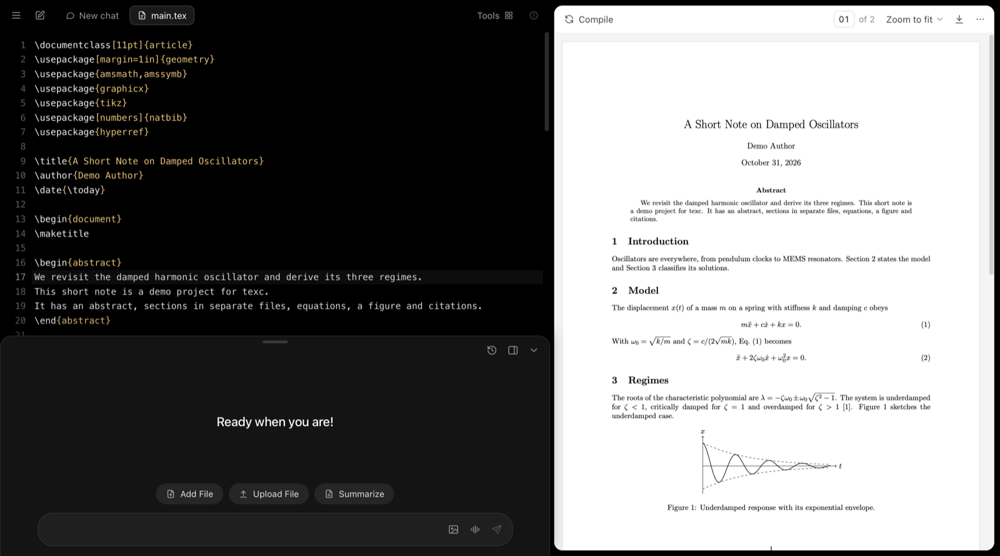
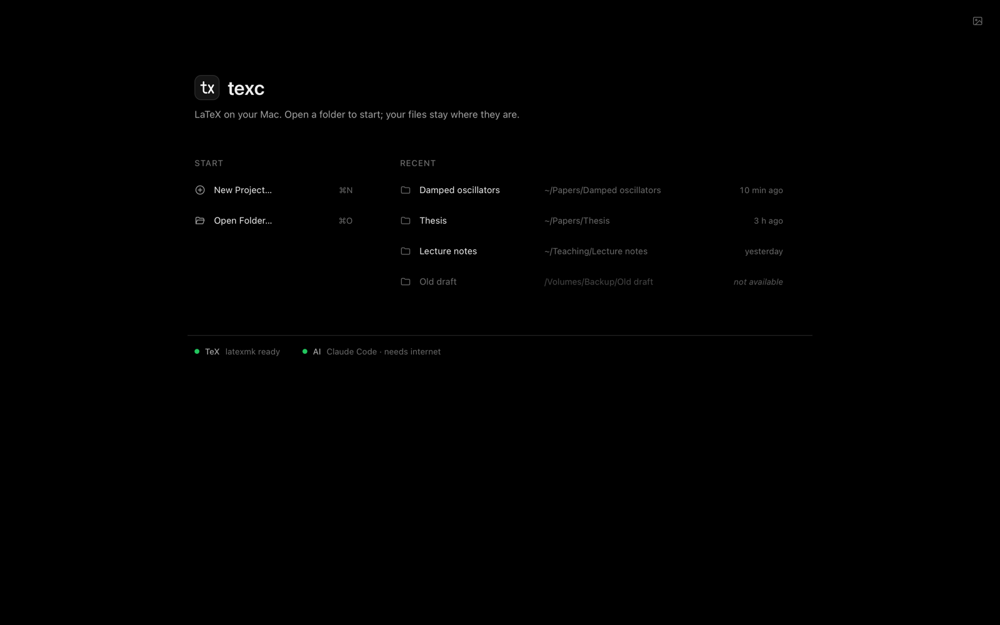

# texc

**A local LaTeX editor for macOS: write, compile and preview, with an AI assistant that proposes edits you review inline.**

Open any folder, the way you'd open one in VS Code, and texc treats it as your project. Your files stay
where they are: Desktop, Documents, an external drive, a git repo. Everything runs on your Mac. Only the
optional AI assistant talks to the internet.



<p align="center">
  
  
</p>

## Features

- **Native Mac app.** Each window is one folder. You get the Welcome screen with recent folders, **Open Folder… (⌘O)**,
  **New Project… (⌘N)** with templates, Open Recent, Reveal in Finder, and multiple windows.
- **Live preview.** Save to compile with latexmk, using pdfLaTeX, XeLaTeX or LuaLaTeX picked automatically. The PDF
  reloads and keeps its scroll position. Errors show in a Problems list that jumps to the line, and SyncTeX works both ways
  (double-click the PDF to go to the source).
- **AI edits you can review.** Ask Claude about your paper or select text and press ⌘K. Proposed changes appear in the
  editor as red/green hunks; press **Keep (⌥Y)** or **Undo (⌥N)** for each one. Nothing changes without your say-so.
- **Writing tools.** Literature search on arXiv with one-click BibTeX, word count, "fix errors with AI", a
  proofreading pass, and math preview in the chat.
- **Offline-friendly.** Editing, compiling and previewing never need the internet.
- **Also a CLI.** `texc paper.tex` is a fast, readable latexmk front end with a watch mode.
- **Themeable Welcome screen.** Use any picture as a semi-transparent background.

## Requirements

- macOS 13 or later
- A TeX distribution with `latexmk`: [MacTeX](https://tug.org/mactex/), or `brew install --cask mactex-no-gui`
- Python 3.9+ (the system `/usr/bin/python3` is fine; texc uses only the standard library)
- Xcode Command Line Tools (`xcode-select --install`), to build the app
- Optional, for the AI assistant: [Claude Code](https://docs.anthropic.com/en/docs/claude-code), signed in (`claude`).
  The OpenAI Codex CLI also works as an alternative provider.

## Install

```sh
git clone https://github.com/Eggan1/texc.git ~/.local/share/texc
ln -s ~/.local/share/texc/texc.py ~/.local/bin/texc     # the `texc` command (make sure ~/.local/bin is on PATH)
texc install-app                                         # builds ~/Applications/texc.app (about 10 s)
```

Then open **texc** from `~/Applications`, Spotlight or Launchpad, or run `texc app ~/path/to/paper-folder`.

The first time texc opens something on your Desktop, in Documents or on an external drive, macOS asks for
permission once. Click Allow.

## Using it

| Command | What it does |
|---|---|
| `texc app [folder]` | Open the Mac app (on a folder) |
| `texc gui [folder or file.tex]` | Same workspace in your browser instead of the app |
| `texc new my-paper [-t blank\|article]` | Create a project from a template |
| `texc paper.tex` | Compile once and print errors and warnings |
| `texc -w paper.tex` | Recompile on every save |
| `texc --clean` | Remove build files (they live in a hidden `.texc/` folder) |

In the app: **⌘S** saves and compiles, **⌘↵** compiles, **⌘K** asks AI about the selection, **⌘F** finds, and **☰**
opens the file drawer with its folder menu. The AI model (Claude: default/opus/sonnet/haiku) is under **Tools → Settings**.

## Privacy

texc has no accounts and no telemetry. It writes into your project folder only the hidden `.texc/` build
folder and anything you create. Settings, recent folders and window state live in `~/.config/texc/`. When you
use the AI assistant, the relevant project text is sent to the AI provider through its CLI (Claude Code or Codex),
under that provider's terms.

## How it works

The Mac app is a small Swift shell. Each window runs its own local Python server, bound to `127.0.0.1` with a
per-session token, and shows the web front end in WebKit. See [docs/ARCHITECTURE.md](docs/ARCHITECTURE.md) for the
processes, HTTP API, bridge and test tools.

## Development

- No build step for the front end: edit `gui/` and reload the window (View → Reload Page, ⇧⌘R).
- Rebuild the app after changing `app/texc.swift`: `bash app/build.sh`.
- End-to-end check, which runs the app invisibly in automation mode: `python3 app/test/final_check.py`.

## License

[MIT](LICENSE). The bundled libraries (CodeMirror, PDF.js, KaTeX, marked, DOMPurify) keep their own licenses;
see [THIRD_PARTY_NOTICES.md](THIRD_PARTY_NOTICES.md).
