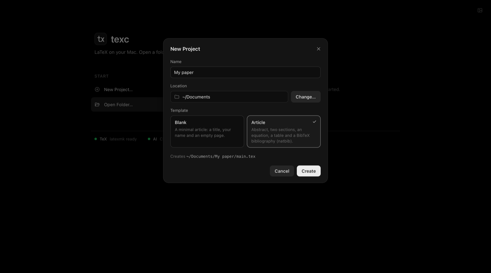

# texc

**A local LaTeX editor for macOS: write, compile and preview, with an AI assistant that proposes edits you review inline.**

Open any folder, the way you'd open one in VS Code, and texc treats it as your project. Your files stay
where they are: Desktop, Documents, an external drive, a git repo. Everything runs on your Mac. Only the
optional AI assistant talks to the internet.


<p align="center">
  
  
</p>

## Features

- **Native Mac app.** Each window is one folder. You get the Welcome screen with recent folders, **Open Folder… (⌘O)**,
  **New Project… (⌘N)** with templates, Open Recent, Reveal in Finder, and multiple windows.
- **Live preview.** Save to compile with latexmk, using pdfLaTeX, XeLaTeX or LuaLaTeX picked automatically. The PDF
  reloads and keeps its scroll position. Errors show in a Problems list that jumps to the line, and SyncTeX works both ways
  (double-click the PDF to go to the source).
- **AI edits you can review.** Ask Claude about your paper or select text and press ⌘K. Proposed changes appear in the
  editor as red/green hunks; press **Keep (⌥Y)** or **Undo (⌥N)** for each one. Nothing changes without your say-so.
- **Results after `=`.** Type `=` after a formula in math mode and its value appears as ghost text, with a
  rendered preview. **Tab** inserts it. When there are two ways to write it (a fraction and a decimal), both are listed: **↑ ↓** choose, and **Tab** or **Enter** inserts the chosen one (**⌥Tab** still inserts the second directly). Any other key dismisses it. This covers
  arithmetic, fractions, roots, trig and logs, integrals, derivatives, limits, sums and products, and matrices
  (inverse, transpose, determinant). For example, `\int_0^1 x^2\,dx =` offers `\frac{1}{3}` and `\sqrt{2} =` offers
  `\approx 1.414213562`. Plain arithmetic written as text works too: `$p_x$ = 0.2 + 0.1 + 2(0.05 + 0.05) =` offers
  `0.5`, inserted as text (fractions as `1/2`). It runs locally with [SymPy](https://www.sympy.org).
- **Step by step.** A line can carry several `=`: write the expression, expand it, and the last `=` still gives
  the answer. `\int_0^x 2t\,dt = \left[t^2\right]_0^x =` offers `x^{2}`, in one line or continued with `&=` in
  `align`. A step that doesn't equal the first expression gets a warning under its result:
  `\int_0^1 x^2\,dx = \frac{1}{2} =` says it doesn't match the integral, which is `\frac{1}{3}`.
- **Statistics and ML after `=`.** Declare a variable once, `X \sim N(100, 15^2)`, and `P(X > 130) =` offers
  `\approx 0.02275013195`. The second row (**↓**, or **⌥Tab**) is the table-style value, 0.0228. Also covered:
  - `P(…)` with `<`, `\le`, `|X|`, ranges and `\mid`, plus `E[…]`, `\operatorname{Var}`, `SD`, `Cov` and `Corr`;
  - normal, binomial, Poisson, exponential, uniform, Bernoulli, geometric, $t$, $\chi^2$, $F$ and beta variables;
  - critical values `z_{0.025}`, `t_{0.025,10}`, `\chi^2_{0.05,3}` and `F_{0.05,2,10}`, and `\Phi(1.96)` and
    `\Phi^{-1}(0.975)`;
  - data summaries, `\operatorname{mean}(…)`, `median`, `mode`, `Var` and `sd`;
  - ML helpers: `sigmoid`, `ReLU`, `softmax`, `softplus`, vector norms `\|v\|`, dot `\cdot` and cross `\times`
    products;
  - confidence intervals, where `52 \pm 1.96 \cdot 1 =` offers `(50.04, 53.96)`.
- **Writing tools.** Literature search on arXiv with one-click BibTeX, word count, "fix errors with AI", a
  proofreading pass, and math preview in the chat.
- **Offline-friendly.** Editing, compiling and previewing never need the internet.
- **Also a CLI.** `texc paper.tex` is a fast, readable latexmk front end with a watch mode.
- **Themeable Welcome screen.** Use any picture as a semi-transparent background.

## Requirements

- macOS 13 or later
- A TeX distribution with `latexmk`: [MacTeX](https://tug.org/mactex/), or `brew install --cask mactex-no-gui`
- Python 3.9+ (the system `/usr/bin/python3` is fine; texc itself uses only the standard library)
- Optional, for results after `=`: SymPy (`/usr/bin/python3 -m pip install --user sympy`)
- Xcode Command Line Tools (`xcode-select --install`), to build the app
- Optional, for the AI assistant: [Claude Code](https://docs.anthropic.com/en/docs/claude-code), signed in (`claude`).
  The OpenAI Codex CLI also works as an alternative provider.

## Install

```sh
git clone https://github.com/Eggan1/texc.git ~/.local/share/texc
ln -s ~/.local/share/texc/texc.py ~/.local/bin/texc     # the `texc` command (make sure ~/.local/bin is on PATH)
texc install-app                                         # builds ~/Applications/texc.app (about 10 s)
```

Then open **texc** from `~/Applications`, Spotlight or Launchpad, or run `texc app ~/path/to/paper-folder`.

The first time texc opens something on your Desktop, in Documents or on an external drive, macOS asks for
permission once. Click Allow.

## Using it

| Command | What it does |
|---|---|
| `texc app [folder]` | Open the Mac app (on a folder) |
| `texc gui [folder or file.tex]` | Same workspace in your browser instead of the app |
| `texc new my-paper [-t blank\|article]` | Create a project from a template |
| `texc paper.tex` | Compile once and print errors and warnings |
| `texc -w paper.tex` | Recompile on every save |
| `texc --clean` | Remove build files (they live in a hidden `.texc/` folder) |

In the app: **⌘S** saves and compiles, **⌘↵** compiles, **⌘K** asks AI about the selection, **⌘F** finds, and **☰**
opens the file drawer with its folder menu. The AI model (Claude: default/opus/sonnet/haiku) and the "Results after ="
switch are under **Tools → Settings**.

How `=` results read your math:
- `\log` is the natural log (use `\log_{10}` for base 10).
- `[F]_a^b` and `F \Big|_a^b` (any bracket size, `\left. … \right|` too) are F(b) − F(a). The variable is the one
  F has, or the one the bounds don't use (`[x t^2]_0^x` is in t); name it when that isn't clear, `[…]_{t=0}^{t=x}`.
  `[x+1]^2` is still a power. A bar takes everything before it in its group; a second bar takes its own term
  (`F\Big|_0^1 + G\Big|_0^1`).
- In a chain `A = B = C =`, the result is C's value. The earlier sides matter in two cases:
  - C is empty or can't be read (`F(x) - F(0)`): the result is the value of the first side that has one, and the
    note says whose value it is.
  - C surely differs from that side: the note warns. texc warns only when it is certain, so it stays quiet when
    the sides use different variables (`2x + 3x = 10`, or a value put in for `r`), when the last side has decimals
    that may be rounded (`\sqrt{2} + 1 = 1.414 + 1`), and for `+ C`, statistics and matrices.
  - A chain ends at `,` `;` `\quad`, another relation (`\le`, `\approx`, `:=`) or a new `align` line that doesn't
    start with `&=`. Names and plain numbers (`p_x = … =`, `y = 3x + 2 =`) are never the side to compare with.
- `i` and `e` are the imaginary unit and Euler's number, except as a sum index.
- `x^23` is read the way TeX typesets it (x² times 3), so write `x^{23}`.
- Names before brackets, like `f(x)`, `P(A)` or `\sigma(z)`, are functions whose values texc doesn't know, so they get no result. So does `x_i` inside `\sum_i`.
- `P(…)`, `E[…]` and `\operatorname{Var}(…)` need the variable's distribution, written as `X \sim …` before the `=`
  (the nearest one wins; commented-out lines don't count; `X, Y \sim …` declares both). Without one, they get no
  result, and so does a variable last declared with something texc can't read, like `\text{Gamma}(2, 3)` or
  `N(0, I)`. The only built-in is `Z`, the standard normal.
- What a result assumes is shown under it:
  - `N(\mu, \sigma^2)` takes the variance, so `N(100, 15)` has sd √15; write `N(100, 15^2)` for sd 15.
  - `\text{Exp}(\lambda)` takes the rate.
  - `\text{Geom}(p)` counts trials 1, 2, ….
  - `z_{\alpha}`, `t_{\alpha,\nu}` and `\chi^2_{\alpha,\nu}` have upper-tail area α.
  - Data `Var`/`sd` divide by n − 1.
  - Several variables are independent. Events about more than one variable are computed only when the variables are
    normal and the event is about a linear combination of them, such as `P(X - Y > 0)`.
- Sigmoid is `\operatorname{sigmoid}`. `\sigma(z)` stays a function name, since σ is also the standard deviation.
- A number that can be written both ways offers both: a fraction with its decimal as the second row, and a decimal
  (from a sum with decimals) with its fraction, so `0.2 + 0.5 =` offers `0.7` and `\frac{7}{10}`.
- A rounded decimal turns the `=` into `\approx` when you insert it (`$\approx$` outside math).
- `=` typed right after inline math has closed, as in `$f_x = \int_0^x 2\,dy$ =`, gives that formula's value in its
  own `$…$` (a plain number goes in as text).
- Outside math, only plain arithmetic (numbers, `+ - * / × ÷` and brackets) counts, standing apart from the words before it
  (`x2+3 =` and `f(2+3) =` stay quiet, and so do comments and the preamble).

## Privacy

texc has no accounts and no telemetry. It writes into your project folder only the hidden `.texc/` build
folder and anything you create. Settings, recent folders and window state live in `~/.config/texc/`. When you
use the AI assistant, the relevant project text is sent to the AI provider through its CLI (Claude Code or Codex),
under that provider's terms.

## How it works

The Mac app is a small Swift shell. Each window runs its own local Python server, bound to `127.0.0.1` with a
per-session token, and shows the web front end in WebKit. See [docs/ARCHITECTURE.md](docs/ARCHITECTURE.md) for the
processes, HTTP API, bridge and test tools.

## Development

- No build step for the front end: edit `gui/` and reload the window (View → Reload Page, ⇧⌘R).
- Rebuild the app after changing `app/texc.swift`: `bash app/build.sh`.
- End-to-end check, which runs the app invisibly in automation mode: `python3 app/test/final_check.py`.
- Checks for the `=` results (math, statistics and chain tables, server, typing in headless Chrome): `python3 app/test/calc_check.py`.

## License

[MIT](LICENSE). The bundled libraries (CodeMirror, PDF.js, KaTeX, marked, DOMPurify) keep their own licenses;
see [THIRD_PARTY_NOTICES.md](THIRD_PARTY_NOTICES.md).
